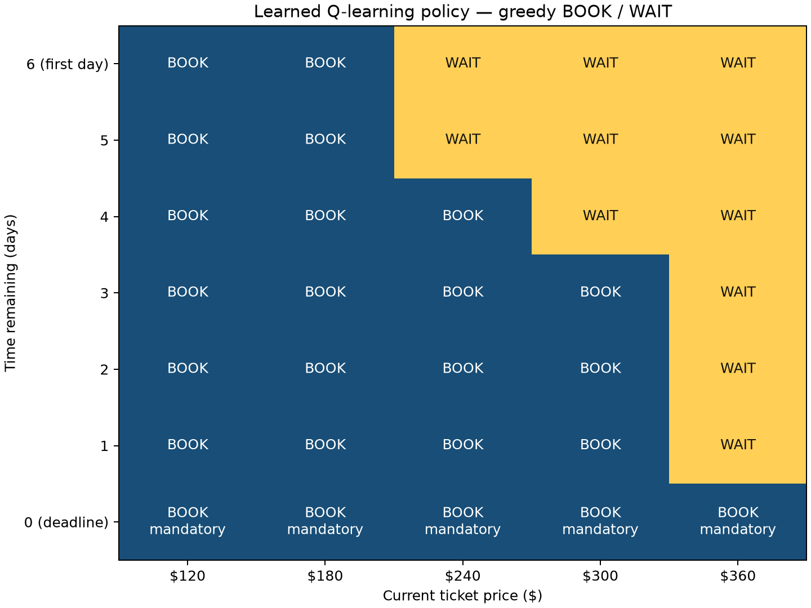

# Flight Booking Decision Assistant

CS664 Term Project | Prepared for Sheung Wan Wong | October 14, 2026

## 1. Project goal and simulator

This project uses tabular Q-learning in Python to decide when a simulated traveler should buy a ticket before a fixed departure date. The agent observes the current fare and time remaining, then chooses BOOK or WAIT. The goal is to reduce expected purchase cost compared with three simple booking rules. The learned policy is also compared with the optimal policy for the simulator's Markov decision process (MDP), which defines the states, actions, and transition probabilities. Supplementary experiments examine how training budget and learning rate affect performance.

The state is (time remaining, current price). The traveler has seven daily opportunities to buy, from time 6 to time 0. The possible fares are $120, $180, $240, $300, and $360. Each episode starts at one of these five prices, with an equal probability of 20% for each. When the agent waits, the next price is sampled using the probabilities for the current time remaining.

| Time before WAIT | +$60 | Unchanged | −$60 |
| --- | --- | --- | --- |
| 6–3 | 30% | 30% | 40% |
| 2–1 | 60% | 20% | 20% |

WAIT gives a reward of 0 and reduces the time remaining by one. A price change beyond $120–$360 leaves the fare at the nearest boundary. BOOK gives a reward equal to the negative current fare and ends the episode. At time 0, purchase is mandatory, so a WAIT request is treated as BOOK. Further actions raise an error until the simulator is reset. The model excludes refunds, cancellations, and sold-out events. All probabilities are hypothetical.

## 2. Training and Q-value updates

The implementation follows the Q-learning method of Watkins and Dayan (1992). Q(state, action) estimates the total reward from taking an action and then choosing the actions with the highest Q-values in later states. Each training episode is one simulated trip ending in a purchase. Because rewards are negative purchase costs, a larger Q-value is better. All entries start at zero. The agent learns from observed transitions without being given their probabilities.

| Original setting | Value and meaning |
| --- | --- |
| Training episodes / seeds | 50,000 trips; training seed 66401, test seed 66402. Seeds initialize reproducible random-number streams. |
| Alpha (learning rate) | 0.1; controls how much each new target changes the current estimate. |
| Gamma (discount factor) | 1.0; future rewards are not discounted. |
| Epsilon and its schedule | Epsilon is the probability of a random action during training. It decreases linearly from 1.0 initially to 0.05 by episode 40,000, then stays at 0.05. |
| Greedy evaluation | Choose the largest legal Q-value; ties choose BOOK. Epsilon 0 means no random exploration. No Q updates means the trained table stays fixed throughout evaluation. |

## 2. Training and Q-value updates (continued)

Each update changes the Q-value for the current state and action: Q_new = Q_old + alpha × (target − Q_old). For BOOK, the target is the observed reward because the episode ends with the purchase. For WAIT, target = reward + gamma × the highest Q-value among the allowed actions at the observed next state. If that next state is the deadline, only BOOK is allowed. The agent observes the next state after acting; it does not know future prices in advance.

## Actual BOOK update — original training log

Episode 1, current state (6, $120), action BOOK. Observed reward = -120; old current Q = 0; target = -120; alpha = 0.1; updated current Q = -12. This purchase ends the episode, so no next-state value is used. Arithmetic: 0 + 0.1 × (−120 − 0) = −12.

The BOOK update is recorded in results/run_summary.json. The saved logs and Notebook outputs contain no complete WAIT example with both the observed next state and its Q-values at that moment in training. The following example therefore uses explicitly assumed values.

## Illustrative WAIT update — assumed Q-values, not an actual training log

| Component | Hypothetical value |
| --- | --- |
| Current state / action | (1, $240) / WAIT |
| Observed next state in this example | (0, $180) |
| Immediate reward | 0 |
| Assumed next-state legal Q-values | Q(BOOK) = −180; WAIT is illegal at the deadline. |
| Assumed old current Q(WAIT) | −200 |
| Gamma / alpha | 1 / 0.1 |
| Target | 0 + 1 × (−180) = −180 |
| Updated current Q(WAIT) | −200 + 0.1 × [−180 − (−200)] = −198 |

This update changes Q((1, $240), WAIT), not the next-state entry. Ticket prices are limited to $120–$360, while Q-values are learned reward estimates and need not equal a valid ticket price. The old value −200 and next-state value −180 here are assumed estimates.

The complete table on the next page contains final values after 50,000 training episodes, from results/q_values.npy. There are 7 time values × 5 prices × 2 actions = 70 stored entries, with 65 legal state/action pairs. Deadline WAIT is not allowed. Values are rounded to three decimals; greedy actions use unrounded values. This final learned table is separate from the logged BOOK update and illustrative WAIT example above. Even BOOK estimates can differ from the known negative fare after finite training.

For example, at (6, $120), Q(BOOK) = -120.000 exceeds Q(WAIT) = -148.415, so the policy chooses BOOK. At (6, $300), Q(WAIT) = -268.136 exceeds Q(BOOK) = -300.000, so it chooses WAIT. The larger (less negative) legal estimate determines the action; these estimates do not establish optimality.

## 2. Complete original trained Q-table

| Time remaining | Price | Q(BOOK) | Q(WAIT) | Greedy action |
| --- | --- | --- | --- | --- |
| 6 | $120 | -120.000 | -148.415 | BOOK |
| 6 | $180 | -180.000 | -181.837 | BOOK |
| 6 | $240 | -240.000 | -225.957 | WAIT |
| 6 | $300 | -300.000 | -268.136 | WAIT |
| 6 | $360 | -360.000 | -293.377 | WAIT |
| 5 | $120 | -120.000 | -132.190 | BOOK |
| 5 | $180 | -180.000 | -182.415 | BOOK |
| 5 | $240 | -240.000 | -231.913 | WAIT |
| 5 | $300 | -300.000 | -273.533 | WAIT |
| 5 | $360 | -360.000 | -304.489 | WAIT |
| 4 | $120 | -120.000 | -138.124 | BOOK |
| 4 | $180 | -180.000 | -181.505 | BOOK |
| 4 | $240 | -240.000 | -247.487 | BOOK |
| 4 | $300 | -300.000 | -291.629 | WAIT |
| 4 | $360 | -360.000 | -312.530 | WAIT |
| 3 | $120 | -120.000 | -140.532 | BOOK |
| 3 | $180 | -180.000 | -190.639 | BOOK |
| 3 | $240 | -240.000 | -248.993 | BOOK |
| 3 | $300 | -300.000 | -303.299 | BOOK |
| 3 | $360 | -360.000 | -326.366 | WAIT |
| 2 | $120 | -120.000 | -153.879 | BOOK |
| 2 | $180 | -180.000 | -208.834 | BOOK |
| 2 | $240 | -240.000 | -261.968 | BOOK |
| 2 | $300 | -300.000 | -327.361 | BOOK |
| 2 | $360 | -360.000 | -335.198 | WAIT |
| 1 | $120 | -119.734 | -155.873 | BOOK |
| 1 | $180 | -179.998 | -208.205 | BOOK |
| 1 | $240 | -240.000 | -256.198 | BOOK |
| 1 | $300 | -300.000 | -313.791 | BOOK |
| 1 | $360 | -360.000 | -348.515 | WAIT |
| 0 | $120 | -108.183 | Not allowed | BOOK |
| 0 | $180 | -179.788 | Not allowed | BOOK |
| 0 | $240 | -239.958 | Not allowed | BOOK |
| 0 | $300 | -300.000 | Not allowed | BOOK |
| 0 | $360 | -360.000 | Not allowed | BOOK |

## 3. Original sampled four-strategy comparison

Q-learning used 50,000 training episodes with seed 66401; the three fixed baselines required no training. All four used the same 10,000 new seven-price test paths, generated with NumPy seed 66402. Only the evaluator sees full paths; strategies see the current state and must buy by the deadline. The $180 threshold was cheapest among the five fare-level thresholds under the known model. Its selection used no test results. The agent was not given the model.

| Strategy | Rule | Sample mean cost |
| --- | --- | --- |
| Immediate booking | BOOK first day | $239.58 |
| Minimum-price rule ($120) | BOOK at $120; else deadline | $223.48 |
| Fixed-threshold rule ($180) | BOOK at $180 or below; else deadline | $219.74 |
| Q-learning (greedy) | Original greedy policy | $214.85 |

Q-learning had the lowest sample mean cost ($214.85). It saved an average of $4.88 per trip compared with the best-performing baseline, the $180 threshold rule.

| Baseline | Mean paired saving | Individual paired 95% CI |
| --- | --- | --- |
| Immediate booking | $24.73 | [$23.84, $25.61] |
| Minimum-price rule ($120) | $8.62 | [$7.24, $10.00] |
| Fixed-threshold rule ($180) | $4.88 | [$4.03, $5.74] |

Paired saving is baseline cost minus Q-learning cost on the same path. Each 95% confidence interval (CI) is mean saving ± t × SD/√10,000, where SD is the sample standard deviation of paired savings and t is SciPy's Student-t multiplier (97.5th percentile; 9,999 degrees of freedom). All intervals are positive, supporting average savings for this trained policy. These large-sample intervals concern mean savings, not individual trips or retraining variation. They apply separately to each baseline, without a joint 95% guarantee.

Evidence: results/mean_cost_comparison.csv, results/paired_savings_95ci.csv, and results/paired_purchase_costs.csv.

## 4. Exact model expectations

Backward induction compares buying now with waiting and then acting optimally, starting from mandatory purchase at the deadline. Learned-policy evaluation instead follows the learned actions. Both use the model's probabilities and average over five equally likely starting fares. These model expectations, calculated to floating-point precision, are distinct from sample means and Q-values. The optimality gap is learned-policy expected cost minus optimal expected cost.

| Analytical reference | Expected cost |
| --- | --- |
| Optimal finite-horizon policy | $207.274224 |
| Original learned policy | $215.709120 |
| Learned minus optimal | $8.434896 |

The learned policy's expected cost is $8.43 above optimal. At (6, $180), it chooses BOOK when WAIT is optimal. Its $214.85 sample mean differs from the $215.709120 expectation because of sampling variation. Evidence: results/exact_mdp_comparison.csv and results/exact_state_values.csv.

## 5. Original learned policy and complete decision trace

The heatmap shows how the learned decision depends on time remaining. At $240, the policy chooses WAIT at times 6–5 and BOOK at times 4–0. At $120, it always chooses BOOK. These are learned decisions and may be suboptimal. The table below traces path index 1, the first test example with at least three decisions. It ends at purchase and excludes any later prices.

| Day | Time remaining | Price | Action | Reward |
| --- | --- | --- | --- | --- |
| 1 | 6 | $360 | WAIT | 0 |
| 2 | 5 | $300 | WAIT | 0 |
| 3 | 4 | $360 | WAIT | 0 |
| 4 | 3 | $360 | WAIT | 0 |
| 5 | 2 | $360 | WAIT | 0 |
| 6 | 1 | $360 | WAIT | 0 |
| 7 | 0 | $360 | BOOK | -360 |

The episode ends after 7 decisions with a $360 purchase. This single trip shows how the policy makes decisions. Its high purchase cost does not contradict the average savings measured across all test trips. Evidence: results/q_learning_trace.csv and results/learned_policy_actions.csv.

## 6. Executed verification

| Core check | Cases | Outcome |
| --- | --- | --- |
| simulator transitions | 90 | PASS |
| episode rules | 7 | PASS |
| Q-value updates | 2 | PASS |
| exact MDP reference | 18,225 | PASS |
| policy actions | 5 | PASS |
| paired intervals | 2 | PASS |
| future-price isolation | 400 | PASS |

All checks in the table passed. The exact reference was independently checked by enumerating all 3,645 starting-price/move sequences for each of five policies (18,225 comparisons), using their model probabilities as weights. Supplementary checks also passed for Q updates from nonzero values, mandatory deadline purchases, rewards and invalid actions across all states, and identification of equally optimal actions. They also checked that supplementary training ran independently and preserved the original model.

Logging checks verified update counts, learning rates, update targets, and evaluations at saved training checkpoints. At all 300 checkpoints, evaluation left the Q-table, update counts, and random-number generator state unchanged. The constant-alpha-0.1 runs exactly reproduced the Q-tables, visit counts, and analytical costs from the ten earlier runs at 50,000 and 200,000 episodes. The saved main Notebook contains 80 successfully executed code cells. These checks support the correctness of the tested behavior, but cannot prove that training converges to an optimal policy.

Complete executed records: results/verification_results.csv, results/supplementary_verification.csv, and results/learning_dynamics_verification.csv.

## 7. Supplementary training-budget experiment

For each of seeds 66401, 66411, 66421, 66431, and 66441, a separate model was trained from a zero Q-table for 50,000 and for 200,000 episodes (ten runs). Only the training budget changed. The simulator, alpha 0.1, gamma 1, initialization, and original epsilon schedule stayed fixed. Each final greedy policy was evaluated exactly, averaging over the five equally likely starting fares.

| Episodes | Mean exact cost | Across-seed cost range |
| --- | --- | --- |
| 50,000 | $216.87 | [$215.45, $219.97] |
| 200,000 | $220.98 | [$219.52, $221.91] |

Expected cost increased for all five seeds. The mean across seeds rose from $216.87 to $220.98 (+$4.11). Extra training therefore did not improve these constant-alpha-0.1 runs; the cost for seed 66401 rose by $4.26. In exact evaluation, all ten policies cost less than the immediate-booking and $120 rules; seven also cost less than the $180 rule. The original model visited all 65 allowed state/action pairs but still chose suboptimal actions in seven states. Neither action in those states was among the least-visited quarter of allowed pairs, so these counts alone do not explain the errors.

Full evidence: results/supplementary_training_runs.csv, results/supplementary_paired_gap_changes.csv, results/supplementary_suboptimal_states.csv, and CS664_Flight_Booking.ipynb.

## 8. Supplementary learning-rate experiment

Each of the five seeds was used to train a fresh model for 200,000 episodes under three learning-rate schedules: constant alpha 0.1, constant alpha 0.03, and visit decay, defined as alpha(s,a) = 0.1/(1 + N_previous(s,a)/1000). N_previous counts earlier updates to that state/action pair. After 0, 1,000, and 3,000 updates, the next learning rate is 0.1, 0.05, and 0.025. The scale of 1,000 was chosen before the experiment. All other settings and the greedy evaluation rule stayed the same.

The fifteen runs recorded 300 checkpoints and 2,100 records tracking the seven states where the original policy was suboptimal. Using the same seed across learning-rate conditions does not guarantee identical training experiences: different actions can change later states and which random numbers are used. All runs are retained in the saved evidence, including policies with equal costs.

| Condition | Mean exact cost | Across-seed cost range | Mean optimality gap |
| --- | --- | --- | --- |
| Constant 0.1 | $220.98 | [$219.52, $221.91] | $13.70 |
| Constant 0.03 | $213.32 | [$209.96, $215.93] | $6.05 |
| Visit decay | $209.16 | [$207.93, $209.67] | $1.89 |

Visit decay produced the lowest mean exact cost across the five seeds ($209.16, versus $220.98 for constant 0.1), but its mean optimality gap remained $1.89. Both alternative schedules reduced final expected cost relative to constant alpha 0.1 for every seed. For seed 66401, reductions were $10.01 with alpha 0.03 and $10.29 with visit decay. All final policies still cost more than the optimum. Costs rose and fell between checkpoints under all three schedules. For example, with seed 66401 and alpha 0.1, expected cost rose by $4.72 between 20,000 and 30,000 episodes. Policy actions also changed, but the saved checkpoints do not establish why performance changed. Results use the final models, without selecting a better earlier checkpoint.

Full run and checkpoint evidence: results/learning_dynamics_final_comparison.csv, results/learning_dynamics_paired_comparisons.csv, and results/learning_dynamics_checkpoints.csv. The saved checkpoint plot, results/learning_dynamics_checkpoint_gaps.png, shows all five seeds under each schedule. Its lines connect saved evaluations and do not show changes between checkpoints. RESULTS.md lists the state diagnostics.

## 9. Limitations and conclusions

The original learned policy reduced average cost compared with all three baselines on the test paths. All three confidence intervals support positive mean savings for this policy in the simulator. However, they do not show that retraining will reliably produce the same savings. The implementation passed the recorded checks, but the exact comparison shows that the learned policy is still suboptimal. Passing these checks does not guarantee convergence to the optimal policy.

These findings apply to a simplified simulator with hypothetical probabilities, five fares, a short booking window, and no sold-out events. They do not establish savings on real flights. The supplementary experiments explored five seeds, two training budgets, and three learning-rate schedules. The reported ranges show the lowest and highest costs across those seeds; they are not confidence intervals. Two budgets cannot establish a general training trend. The experiments did not isolate why the learning-rate schedules performed differently, and no further tuning was performed.

All evidence files cited in this report are included in the submitted ZIP, using paths relative to its top-level folder. README.md explains setup and execution, and RESULTS.md lists the complete saved outputs. Monetary summaries are calculated at full precision before rounding; the saved results retain their original precision.
