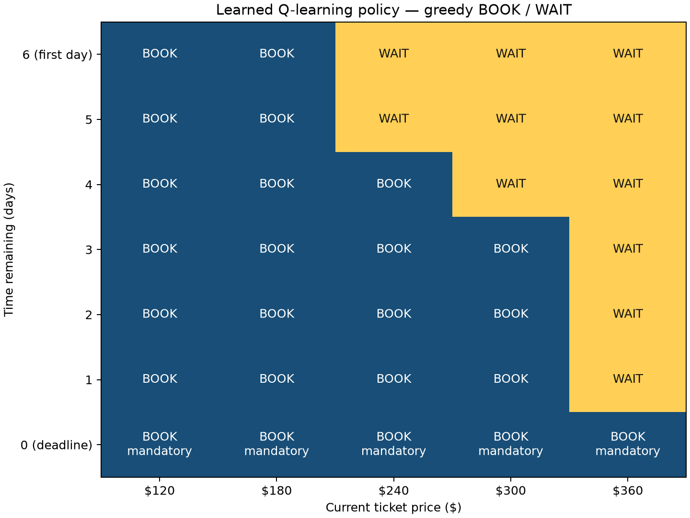
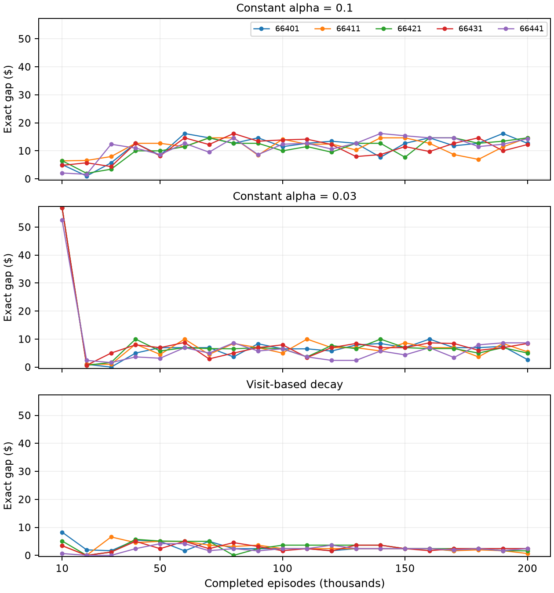

# Flight Booking Decision Assistant

CS664 Term Project | Prepared for Sheung Wan Wong | October 14, 2026

DRAFT — awaiting student review. This report records executed computational work; it does not establish personal practice, presentation readiness, or submission.

## 1. Goal, classification, and scope

This machine learning application uses Python tabular Q-learning to choose BOOK or WAIT for a simulated traveler with a fixed departure date. Its goal is to investigate whether current fare and time remaining reduce expected purchase cost relative to simple booking rules. It is a small teaching model, not a real-airfare forecasting service.

The original English proposal planned a seven-opportunity simulator, 50,000 training episodes, a four-strategy comparison on 10,000 fresh shared price paths, paired uncertainty estimates, an exact MDP reference, a policy heatmap, a trace, and program checks. That scope was completed without revising the proposal or changing the simulator or four strategies. Later exploratory extensions investigated five seeds at two training budgets and three prespecified learning-rate conditions. These extensions remain separate from the original policy and its sampled comparison.

The three validation questions are: (1) Does Q-learning reduce cost versus the baselines? (2) How reliable are the observed savings? (3) How close is the learned policy to optimal, and does the implementation follow the rules? The instructor's CS664 Term Project PDF supplies the official requirements; the proposal is the implementation plan [1, 2].

## 2. Simulator and decision process

State is (time remaining, current price). Seven daily purchase opportunities run from time 6 to time 0, with prices $120, $180, $240, $300, and $360. The initial price is uniform over these five levels. This is an artificial teaching horizon, not a recommended real-world booking window.

| Time before WAIT | +$60 | Unchanged | -$60 |
| --- | --- | --- | --- |
| 6–3 | 30% | 30% | 40% |
| 2–1 | 60% | 20% | 20% |

WAIT gives reward 0, reduces time by one, and samples the next price using the regime before the action. An attempted move outside $120–$360 stays at the boundary. BOOK pays the current fare, gives reward equal to its negative, and terminates. At time 0 only BOOK is legal; a requested WAIT is converted to BOOK. Further steps after purchase raise an error until reset. There are no refunds, cancellations, or sold-out events. Probabilities are hypothetical, not measured flight-price patterns.

## 3. Q-learning method and key code

Q-learning updates state/action values from observed rewards and next states [3]. The agent does not receive the transition-probability table. Maximizing the undiscounted negative purchase reward minimizes eventual cost. The Q-table starts at zero with shape 7 × 5 × 2; 65 state/action pairs are legal because deadline WAIT is excluded. Greedy ties choose BOOK.

| Original setting | Value |
| --- | --- |
| Training episodes | 50,000 |
| Learning rate / gamma | 0.1 / 1.0 |
| Training / test seeds | 66401 / 66402 |
| Exploration | Epsilon 1.0 on episode 1 to 0.05 on episode 40,000; hold 0.05 afterward |
| Evaluation | Greedy actions, epsilon 0, no Q updates |

The update is Q_new = Q_old + alpha × (target − Q_old). For terminal BOOK, target = reward only. Otherwise target = reward + gamma × the largest legal next-state Q-value. At a deadline next state, only BOOK enters the bootstrap target.

| Actual logged update | Observed value |
| --- | --- |
| Episode / state / action | 1 / (6, $120) / BOOK |
| Old value | 0.0 |
| Reward / terminal target | -120 / -120 |
| Alpha | 0.1 |
| Updated value | -12.0 |

Thus 0 + 0.1 × (-120 − 0) = -12. An actual WAIT update at episode 376, state (1, $240), had old value 0, reward 0, target -30, and updated value -3. With gamma 1, its best legal future estimate at that training moment was -30; this is not the final Q-table's exact expected cost.

| Key code | Purpose |
| --- | --- |
| next_price; FlightBookingEnv.step | Probability regimes, clipping, rewards, forced deadline purchase, and termination |
| update_q; choose_training_action | Terminal/nonterminal targets, epsilon-greedy exploration, and legal greedy actions |
| train_q_learning; play_path | Independent episode training and stop-at-purchase state-only evaluation |
| solve_optimal_mdp; exact_policy_values | Backward induction and fixed-policy analytical expectations |

## 4. Original sampled four-strategy evaluation

All strategies were evaluated on the same 10,000 new seven-price trajectories, generated with test seed 66402, separate from original training seed 66401. Pre-generation belongs to the evaluator: every decision function receives only its current state, never future prices. Evaluation stops at purchase, forces deadline booking, uses no exploration, and leaves Q unchanged. NumPy's seeded Generator supports reproducible random streams [5].

| Strategy | Rule | Sample mean cost |
| --- | --- | --- |
| Immediate booking | BOOK first day | $239.580 |
| Minimum-price rule ($120) | BOOK at $120; else deadline | $223.476 |
| Fixed-threshold rule ($180) | BOOK at $180 or below; else deadline | $219.738 |
| Q-learning (greedy) | Original 50,000-episode greedy policy | $214.854 |

The $180 baseline was chosen from analytical model knowledge in the original proposal, not by searching the test trajectories. The original Q-learning policy is retained; improved supplementary models do not replace it.

| Baseline | Mean paired saving | Individual paired 95% CI |
| --- | --- | --- |
| Immediate booking | $24.726 | [$23.837947, $25.614053] |
| Minimum-price rule ($120) | $8.622 | [$7.240777, $10.003223] |
| Fixed-threshold rule ($180) | $4.884 | [$4.029366, $5.738634] |

Saving is baseline cost minus Q-learning cost on the same trajectory. The interval is mean(d) ± t(0.975, 9999) × sample_sd(d)/sqrt(10000), using SciPy's Student-t quantile [4]. All three intervals are above zero for this fixed policy and sample. They are large-sample approximations for mean savings, not ranges containing 95% of individual-trip savings; they are not simultaneous intervals and do not measure variability across training seeds.

## 5. Analytical optimality reference, policy, and trace

Backward induction uses the known simulator: V*(0,p)=p and V*(t,p)=min[p, sum P(p'|t,p)V*(t−1,p')]. A fixed policy chooses its action instead of taking the minimum. Average over the five uniform starting prices. These are full-model analytical expectations to floating-point precision, distinct from the finite test sample.

| Analytical reference | Expected cost |
| --- | --- |
| Optimal finite-horizon policy | $207.274224 |
| Original learned policy | $215.709120 |
| Learned minus optimal | $8.434896 |

The original policy is suboptimal despite beating the simple rules in the sampled experiment. For example, at (6, $180) it BOOKs while the exact optimal action is WAIT. Its sampled $214.854 cost differs from its analytical $215.709120 expectation because only 10,000 test trips were sampled; Q-values themselves are estimates, not exact policy costs.

The complete original trace below is trajectory index 1, selected as the first test example with at least three decisions. It is an illustration, not a performance estimator; unseen post-purchase prices are not displayed.

| Day | Time remaining | Price | Action | Reward |
| --- | --- | --- | --- | --- |
| 1 | 6 | $360 | WAIT | 0 |
| 2 | 5 | $300 | WAIT | 0 |
| 3 | 4 | $360 | WAIT | 0 |
| 4 | 3 | $360 | WAIT | 0 |
| 5 | 2 | $360 | WAIT | 0 |
| 6 | 1 | $360 | WAIT | 0 |
| 7 | 0 | $360 | BOOK | -360 |

This episode ended after seven decisions with a final purchase of $360. Average savings are compatible with expensive individual trips.

## 6. Executed verification and execution readiness

| Executed core check | Cases | Outcome |
| --- | --- | --- |
| simulator transitions | 90 | PASS |
| episode rules | 7 | PASS |
| Q-value updates | 2 | PASS |
| exact MDP reference | 18225 | PASS |
| policy actions | 5 | PASS |
| paired intervals | 2 | PASS |
| future-price isolation | 400 | PASS |

The reference expectation was independently verified by enumerating 3,645 latent-move paths per policy for five policies (18,225 comparisons). Supplementary checks also executed nonzero-old-value Q updates, 20 deadline-selector cases, 71 all-state/invalid-action cases, tie-aware action penalties, and preservation of the original model. A differing action is not an error if both exact action costs are equally optimal within numerical tolerance. No algorithm correction was required.

Learning-dynamics instrumentation checked pre-update pair counts, exactly one increment, actual alpha application, terminal/legal targets, independent training state, and read-only checkpoints. All 300 checkpoints preserved Q, counts, and training RNG state. Constant alpha 0.1 reproduced all ten earlier 50,000/200,000 endpoint Q-tables, visit counts, and analytical costs exactly. These are executed finite checks, not proofs of all software behavior or convergence.

The saved fresh-kernel Notebook has 80 successfully executed code cells. Its recorded interval from the first cell's busy timestamp to the final cell's idle timestamp is 182.36 seconds, excluding kernel startup and runner postchecks. Complete CLI wall time was not instrumented. Packaging reused this successful run; no training was rerun for the report or ZIP. A necessary runner portability correction now ignores machine-specific execution metadata and figure bytes when checking numerical fingerprints. Fixtures confirmed relocation is accepted and changed costs are detected.

## 7. Supplementary five-seed/two-budget investigation

The prespecified seeds were 66401, 66411, 66421, 66431, and 66441. Each restarted from zero at 50,000 and 200,000 episodes: ten runs, changing only episode budget. Simulator, alpha 0.1, gamma 1, initialization, and the original epsilon schedule stayed fixed. Each final greedy policy was evaluated analytically under the same uniform initial distribution.

| Seed | Episodes | Exact policy cost | Gap above optimal |
| --- | --- | --- | --- |
| 66401 | 50,000 | $215.709120 | $8.434896 |
| 66401 | 200,000 | $219.965568 | $12.691344 |
| 66411 | 50,000 | $219.965568 | $12.691344 |
| 66411 | 200,000 | $221.913600 | $14.639376 |
| 66421 | 50,000 | $217.266816 | $9.992592 |
| 66421 | 200,000 | $221.913600 | $14.639376 |
| 66431 | 50,000 | $215.453952 | $8.179728 |
| 66431 | 200,000 | $219.522432 | $12.248208 |
| 66441 | 50,000 | $215.933952 | $8.659728 |
| 66441 | 200,000 | $221.577600 | $14.303376 |

| Episodes | Mean exact cost | Across-seed cost range |
| --- | --- | --- |
| 50,000 | $216.865882 | [$215.453952, $219.965568] |
| 200,000 | $220.978560 | [$219.522432, $221.913600] |

All five seeds worsened at 200,000 episodes; for seed 66401 the exact cost increased by $4.256448. All ten models were below the immediate and $120 baselines' exact costs; seven were below the $180 baseline. Two budgets do not establish a continuous trend. Across-seed ranges are descriptive observations over five selected seeds, not the original paired confidence intervals.

The original model had seven strictly suboptimal states. At (6, $180), BOOK/WAIT had 5,469/4,490 visits, and BOOK's exact action penalty with optimal continuation was $16.2168. None of the seven met the descriptive lower-quartile coverage flag (cutoff 326 visits); all 65 legal pairs had been visited. This evidence does not identify the cause of the $8.434896 total gap or establish a causal role for experience coverage.

## 8. Supplementary learning dynamics and rate comparison

To investigate the deterioration without presuming its cause, each of the same five seeds restarted independently for 200,000 episodes under three conditions: constant alpha 0.1; constant alpha 0.03; and alpha(s,a)=0.1/(1+N_previous(s,a)/1000). The counter is this pair's number of updates before the current update, not global episode count. Rates at 0, 1,000, and 3,000 prior updates are 0.1, 0.05, and 0.025. Scale 1,000 was chosen before the experiment, not optimized.

All other settings and the legal greedy evaluator were unchanged. Fifteen instrumented runs recorded 300 checkpoints and 2,100 records for the seven originally suboptimal states, including Q margins, actions, visits, and next-update rates. Changed policies can change subsequent random experience and RNG consumption, so equal seeds across conditions do not guarantee identical training trajectories. All runs, including equal-cost policies, are retained.

| Seed | Rate condition | Final exact cost | Gap above optimal |
| --- | --- | --- | --- |
| 66401 | Constant 0.1 | $219.965568 | $12.691344 |
| 66401 | Constant 0.03 | $209.959872 | $2.685648 |
| 66401 | Visit decay | $209.670624 | $2.396400 |
| 66411 | Constant 0.1 | $221.913600 | $14.639376 |
| 66411 | Constant 0.03 | $212.737440 | $5.463216 |
| 66411 | Visit decay | $207.930624 | $0.656400 |
| 66421 | Constant 0.1 | $221.913600 | $14.639376 |
| 66421 | Constant 0.03 | $212.284032 | $5.009808 |
| 66421 | Visit decay | $208.882224 | $1.608000 |
| 66431 | Constant 0.1 | $219.522432 | $12.248208 |
| 66431 | Constant 0.03 | $215.709120 | $8.434896 |
| 66431 | Visit decay | $209.670624 | $2.396400 |
| 66441 | Constant 0.1 | $221.577600 | $14.303376 |
| 66441 | Constant 0.03 | $215.933952 | $8.659728 |
| 66441 | Visit decay | $209.670624 | $2.396400 |

| Condition | Mean exact cost | Across-seed cost range |
| --- | --- | --- |
| Constant 0.1 | $220.978560 | [$219.522432, $221.913600] |
| Constant 0.03 | $213.324883 | [$209.959872, $215.933952] |
| Visit decay | $209.164944 | [$207.930624, $209.670624] |

Both alternatives lowered every seed's final cost relative to alpha 0.1. For seed 66401, reductions were $10.005696 (0.03) and $10.294944 (decay). Across five seeds, the mean gap was $13.704336, $6.050659, and $1.890720, respectively. Every final policy still had a positive gap. These are exploratory rate-sensitivity findings, not independent confirmation or replacements for the original four-strategy experiment.

| Condition | Improving intervals | Worsening intervals | Unchanged |
| --- | --- | --- | --- |
| Constant 0.1 | 39 | 48 | 8 |
| Constant 0.03 | 46 | 40 | 9 |
| Visit decay | 36 | 26 | 33 |

All conditions fluctuated. For seed 66401 under alpha 0.1, cost rose $4.719312 between 20,000 and 30,000 episodes while four tracked states switched WAIT to BOOK. At final (6, $180), WAIT was chosen by 0/5, 2/5, and 5/5 policies across the three conditions. These switches accompany performance changes; other states can change too. Sparse checkpoints omit intervening changes and do not identify a unique causal mechanism.

## 9. Limitations and answers to the validation questions

1. Cost reduction: the original single-seed policy had the lowest sampled mean among the four rules and positive paired mean savings with intervals above zero. This does not guarantee saving on a particular trip or on real fares.

2. Reliability: original CIs concern test-trajectory uncertainty conditional on one trained policy. Supplementary ranges expose training-seed variation. Rate alternatives improved these five final policies, but the analysis is exploratory and five seeds do not establish universal robustness. No simultaneous inference across all comparisons is claimed.

3. Optimality and correctness: the original analytical gap is $8.434896; smaller supplementary gaps show sensitivity to tested learning-rate settings. Executed tests support the specified implementation and unperturbed instrumentation. They do not prove convergence or explain the full remaining mechanism. Neither alpha 0.03 nor the visit-decay rule is established as optimal; no additional tuning or best-checkpoint selection was performed.

The underlying probabilities, five fare levels, short horizon, and absence of sold-out events are hypothetical. Fixed-step updates can retain sensitivity to sampled targets; decay can alter learning speed and coverage, but the relative contribution of such mechanisms was not isolated. There is no evidence here of real-flight savings. The completed project demonstrates a reproducible reinforcement-learning application and its limits rather than a validated travel recommendation.

## 10. Reproducibility, assistance, and review status

The ZIP provides the executed main Notebook, runner and numerical-verification module, pinned runtime requirements, README, unchanged English proposal, RESULTS.md, and all official result artifacts. README identifies the project virtual-environment interpreter and Python (CS664 Flight Booking) kernel. Report files and recording are separate uploads. Packaging excluded practice work, credentials, environments, caches, Git, local tools, and instructor materials.

Codex assistance disclosure: OpenAI Codex assisted with implementation, execution, verification, supplementary investigations, report drafting, and packaging. Report numbers come from saved actual artifacts. Personal practice, independent understanding, camera-on recording, human report approval, and portal submission have not been established by those automated actions. The student must review this draft and confirm compliance with any syllabus/instructor AI-use guidance. The supplied project PDF does not specify an AI-disclosure rule; this disclosure does not replace other applicable course guidance.

## References and evidence sources

[1] Kalathur, S. (2026). CS664 Term Project. Instructor-provided metcs664_TermProject.pdf. Used for the official deliverables and demo requirements; excluded from the ZIP.

[2] CS664_Project_Wong_Sheung_Wan_Proposal.md. Original supplied English implementation plan, unchanged. CS664_Flight_Booking.ipynb, RESULTS.md, and results/ supply the executed numerical evidence; report_assets/report_number_audit.json maps validation to those artifacts.

[3] Watkins, C. J. C. H., & Dayan, P. (1992). Q-learning. Machine Learning, 8, 279–292. https://doi.org/10.1007/BF00992698. Publisher abstract and bibliographic page consulted for algorithm background; not a claim that this finite project satisfies a convergence theorem.

[4] SciPy contributors. scipy.stats.t API documentation. https://docs.scipy.org/doc/scipy/reference/generated/scipy.stats.t.html. Consulted October 14, 2026 for the Student-t quantile used in paired intervals.

[5] NumPy contributors. Random Generator documentation. https://numpy.org/doc/stable/reference/random/generator.html. Consulted October 14, 2026 for seeded random-generator behavior.

External references were consulted to validate method explanations while drafting, not used as flight-price data. This remains a draft awaiting student review.
